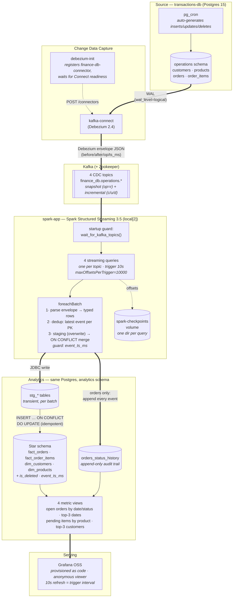

# Architecture

End-to-end streaming analytics pipeline. Every component below maps 1:1 to a
service in `docker-compose.yaml` or a code path in
`docker/spark-app/app/streaming_job.py`.

## Reading the diagram

- **Thick arrows** are the data path; **dotted arrows** are control/metadata
  (connector registration, checkpoint offsets).
- **Historical + current state (MUST HAVE):** the initial Debezium snapshot
  (`op=r`) flows through the same topics and code path as incremental CDC, so
  one streaming job performs both the historical load and the near-real-time
  updates. Current state lives in the star schema (upserted); the full event
  trail lives in `orders_status_history` (append-only).
- **Consistency:** checkpoints + the idempotent `ON CONFLICT` merge guarded by
  `event_ts_ms` give effectively-once semantics for the state tables — a
  replayed micro-batch produces an identical end state.
- **Startup ordering:** on a cold start the Spark app boots before Debezium has
  created the topics; the startup guard polls for topic availability instead of
  failing, and `restart: unless-stopped` covers any other crash.

Cluster sizing strategy and the Spark metrics behind these choices:
[`../docs/cluster-sizing.md`](../docs/cluster-sizing.md).